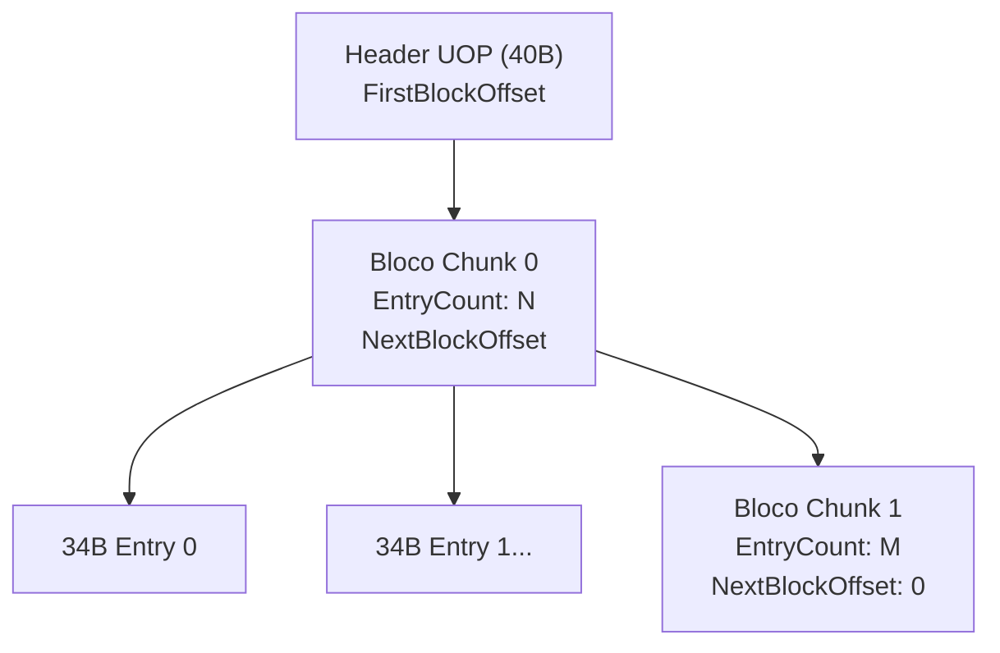
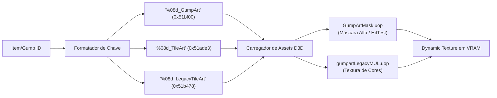

# Análise Estática Reversa: Formato UOP & Pipeline Item ID -> Gump ID no Cliente 3D / Enhanced Client (`UOSA.exe`)

---

## 1. Visão Geral e Contexto Técnico

Este documento apresenta a análise estática e engenharia reversa do executável oficial do cliente 3D / Enhanced Client de *Ultima Online*:
- **Binário Analisado**: `UOSA.exe` (PE32 Intel i386, GUI)
- **Versão do Produto**: `4.0.117.1` (Ultima Online: Stygian Abyss / Enhanced Client)
- **Localização**: `/opt/hd_jogos/UOEC/UOSA.exe`
- **Arquivos de Dados Relacionados**: `GameData.uop`, `tileart.uop`, `Paperdoll.uop`, `gumpartLegacyMUL.uop`, `GumpArtMask.uop`, `Interface.uop`, `Texture.uop`, `UserInterface/Default.zip`.

### Diferenças Arquiteturais Fundamentais entre o Cliente 2D (`client.exe`) e o 3D (`UOSA.exe`):
1. **Eliminação Completa dos Arquivos `.mul`**: O cliente 3D não possui nem lê nenhum arquivo `.mul` bruto. Toda a distribuição de dados foi migrada para pacotes `.uop` (formato MYP versão 5).
2. **Migração de Tabelas `.def` para `.csv`**:
   - `Equipconv.def` ➔ Migrado para `data/gamedata/equipconv.csv` empacotado dentro de `GameData.uop`.
   - Limites de contêineres e gumps ➔ Migrados para `data/gamedata/legacycontainers.csv` em `GameData.uop`.
   - Mapeamento de IDs Legados (2D) para IDs 3D ➔ Implementado na tabela `legacyId,newId,newSubType` em `GameData.uop`.
3. **Gerenciador de Texturas Dinâmicas e Shaders**: Os gumps e artes de itens não são mais blitados pixel-a-pixel por software na CPU; eles são carregados como texturas dinâmicas Direct3D indexadas por máscaras (`%08d_GumpArt`, `%08d_TileArt`, `%08d_LegacyTileArt`).
4. **Interface Baseada em XML + Lua**: A camada de apresentação é dirigida por scripts Lua e templates XML contidos em `Interface.uop` e `UserInterface/Default.zip`.
5. **Paperdoll Híbrido (Dual Pipeline)**: Suporta renderização 3D nativa (mesh esquelético com sockets) ou renderização composta 2D (modo legado com textura dinâmica `paperdoll_texture%d`).

---

## 2. Formato UOP no Cliente 3D (`MYP Versão 5`)

No `UOSA.exe`, a classe responsável é `MypArchive` (desmontada na função `0x991be0`). O motor opera com a versão `5` do formato Mythic Package.

### 2.1. Estrutura do Cabeçalho Global (40 bytes / `0x28`)

Localizado no offset `0x00` de qualquer arquivo `.uop`:

| Offset | Tamanho | Tipo | Campo | Descrição e Validação em `UOSA.exe` |
|---|---|---|---|---|
| `0x00` | 4 bytes | `uint32` | `Magic` | `MYP\0` (`0x0050594d`). Validado em `0x991c33`. |
| `0x04` | 4 bytes | `uint32` | `Version` | Versão `5` (aceita `4` e `5`). Checado: `cmp eax, 4; jb fail; cmp eax, 5; ja fail;` |
| `0x08` | 4 bytes | `uint32` | `Signature` | `0xFD23EC43`. Validado em `0x991c36` (`mov esi, 0xfd23ec43; cmp [edi], esi`). |
| `0x0C` | 8 bytes | `uint64` | `FirstBlockOffset` | Offset absoluto do primeiro bloco de índices. |
| `0x14` | 4 bytes | `uint32` | `BlockCapacity` | Capacidade máxima de entradas no bloco (`100` a `1000`). |
| `0x18` | 4 bytes | `uint32` | `TotalFiles` | Contagem total de arquivos presentes no pacote. |
| `0x1C` | 4 bytes | `uint32` | `BlockCount` | Número de blocos encadeados. |
| `0x20` | 8 bytes | `uint64` | `Reserved` | Flags de controle reservadas. |

---

### 2.2. Encadeamento e Leitura em Chunks

Em vez de carregar a lista completa de arquivos de uma única vez:
1. O cliente salta para `FirstBlockOffset`.
2. Lê o **Cabeçalho do Bloco** (12 bytes):
   - `EntryCount` (`uint32`): Quantidade de registros válidos neste chunk.
   - `NextBlockOffset` (`uint64`): Ponteiro para o próximo chunk (se `0`, indica fim).
3. Lê `EntryCount` registros de **34 bytes** (`0x22`) sequencialmente (`0x991cc0`: `imul ecx, ecx, 0x22`).
4. Aloca um bloco de nós hash e insere as entradas na tabela de busca rápida em memória.



---

### 2.3. Registro do Arquivo (34 bytes / `0x22`)

```c
#pragma pack(push, 1)
struct UOSA_FileEntry
{
    uint64_t DataOffset;       // 0x00: Offset do arquivo compactado no disco
    uint32_t HeaderLength;     // 0x08: Tamanho de metadados antes do fluxo Zlib
    uint32_t CompressedSize;   // 0x0C: Tamanho do chunk compactado
    uint32_t DecompressedSize; // 0x10: Tamanho real após inflate
    uint64_t Hash;             // 0x14: Hash Bob Jenkins lookup3 (64-bit)
    uint32_t Adler32_CRC;      // 0x1C: Checksum de validação
    uint16_t CompressionType;  // 0x20: 0 = Não compactado, 1 = Zlib Deflate
};
#pragma pack(pop)
```

---

## 3. O Pacote Central de Definições: `GameData.uop`

Diferente do cliente 2D que lia arquivos de texto na raiz do diretório (`Equipconv.def`, `gump.def`, etc.), o cliente 3D empacota todas as tabelas relacionais em formato CSV comprimido dentro do `GameData.uop`.

A função `0x403050` (`LoadAllGameDataCSVs`) no `UOSA.exe` inicializa e popula os mapas em memória chamando os seguintes módulos:

| Função | Arquivo CSV Interno | Hash Jenkins (64-bit) | Propósito na Engine 3D |
|---|---|---|---|
| `0x401540` | `data/gamedata/abilities.csv` | `0x9b89e3f7a6ecfcda` | Tabela de habilidades especiais de combate e ícones. |
| `0x401b50` | `data/gamedata/mobart.csv` | `0xafc672e7...` | Mapeamento de Body Types para modelos e texturas 3D (`.dds`). |
| `0x401e00` | `data/gamedata/skilldata.csv` | `0x5a570670...` | Configuração de abas, tooltips e IDs de perícias. |
| `0x4021e0` | `data/gamedata/bugreport.csv` | `...` | Categorias e formulários de bug report. |
| `0x4024a0` | `data/gamedata/weaponability.csv` | `0x45f6df55...` | Associações de armas aos ataques primário e secundário. |
| `0x4027b0` | `data/gamedata/legacyterrainmap.csv`| `...` | Tradução de tiles de terreno legado para shaders 3D. |
| `0x402a00` | `data/gamedata/legacycontainers.csv`| `0x6751791ce840d228` | **Geometria de Contêineres Legados** (GumpID, limites X/Y). |
| `0x402d80` | `data/gamedata/equipconv.csv` | `0x6673acf4cdd91ce2` | **Tabela de Conversão de Equipamentos do Paperdoll**. |
| - | `legacyId,newId,newSubType` (Entry 19) | `0x49cd9be9...` | **Mapeamento direto entre IDs de Arte 2D e IDs 3D**. |

---

## 4. O Mecanismo de Tradução: `Item ID -> Gump ID`

No cliente 3D, existem **dois caminhos** para desenhar um item como Gump ou ícone:
1. **Modo 2D Legado / Paperdoll Clássico**: Usa a arte 2D dos pacotes `gumpartLegacyMUL.uop` e `Paperdoll.uop`.
2. **Modo UI / Grid / Mochila Moderna**: Usa os ícones em DDS renderizados dinamicamente pelo shader `UOSpriteUIShader`.

### 4.1. Migração de `Equipconv.def` para `equipconv.csv`

Desmontado em `0x402d80` - `0x402fe9`:
O `UOSA.exe` faz o parsing linha a linha do CSV com a seguinte estrutura de colunas:

```csv
bodyType,equipmentID,convertToID,gumpIDToUse,hue
```

A rotina de resolução em memória (`0x403230` - `0x403284`):
1. Faz busca no mapa `EquipConvTable[bodyType, equipmentID]`.
2. Se encontrado:
   - Se `gumpIDToUse == -1`: calcula `convertToID + 50000` (`0xC350`).
   - Se `gumpIDToUse > 0`: utiliza diretamente `gumpIDToUse`.
   - Se `gumpIDToUse == 0`: usa `equipmentID + 50000` (base masculino).
3. Se não encontrado:
   - Retorna o fallback padrão `equipmentID + 50000`.

---

### 4.2. Os Filtros de Aparência em `tileart.uop` no Cliente 3D

Assim como identificado no cliente 2D, o motor 3D contém a implementação idêntica das classes de filtro `AppearanceFilter` para gerenciar os itens recentes:
- `AppearanceFilterByOwnerBodyType` (Vtable `0xce4a8c`, Match em `0x84fbd4`)
- `AppearanceFilterByOwnerGender` (Vtable `0xce4ab4`, Match em `0x84fc95`)
- `AnimationAppearanceFilterByOwnerBodyType` (Vtable `0xce4aa0`, Match em `0x84fce0`)

#### Funcionamento no Cliente 3D:
1. O item é identificado pelo seu `ItemID`.
2. O subsistema verifica se existe entrada em `tileart.uop` sob a chave `10000000 + ItemID`.
3. Se o item possuir `subType == 1` (`AppearanceFilterByOwnerGender`):
   - O cliente executa `Owner->GetGender()` (`0x84fcad`).
   - Compara com `filter->TargetGender` (`0x84fcb3`).
   - Se coincidir, substitui a aparência pelo `AppearanceID` correspondente, selecionando a variação feminina/masculina correta para armaduras recentes (como roupas de aniversário, sets de gárgula e elfo).

---

### 4.3. Sistema de Texturas Dinâmicas no Motor Gráfico

Quando o cliente 3D precisa exibir a arte ou gump de um item na interface gráfica (por exemplo, na janela de contêiner ou no slot de equipamento), ele não lê diretamente um frame estático de um arquivo `.mul`. Ele passa pelo subsistema de **Texturas Dinâmicas**:



1. **`RequestGumpArt(gumpId)` (`0x51bf00`)**:
   - Formata a string `%08d_GumpArt` (ex: `00000060_GumpArt`).
   - Busca no pacote `gumpartLegacyMUL.uop`.
   - Lê a máscara de colisão e recorte alfa correspondente em `GumpArtMask.uop` (`Build\GumpArtMask\0%d.dds`).
   - Isso garante o clique pixel-perfect na interface.
2. **`RequestTileArt(tileId)` (`0x51ade3`)**:
   - Formata `%08d_TileArt`.
   - Utilizado para ícones modernos nos slots do paperdoll e hotbars.
3. **`RequestLegacyTileArt(tileId)` (`0x51b478`)**:
   - Formata `%08d_LegacyTileArt`.
   - Utilizado para renderizar itens em mochilas e baús quando o jogador seleciona o modo "Legacy Container View".

---

### 4.4. O Pacote `Paperdoll.uop` e o Formato `AMOU`

O arquivo `Paperdoll.uop` no cliente 3D contém dois arquivos volumosos identificados pelo número mágico `AMOU` (`0x554f4d41`, versão 1):
- **O que é**: `AMOU` significa *Animation Mesh Object / Unit*. É o formato binário interno da Mythic para descrever a geometria 3D composta de personagens humanos, elfos e gárgulas com todas as suas camadas esqueléticas de vestuário.
- **Estrutura interna**:
  - Cabeçalho de 16 bytes: `Magic (AMOU)`, `Version (1)`, `DataSize`, `MeshCount`.
  - Tabelas de vértices, coordenadas UV, pesos de rigging para animação esquelética e mapeamento de texturas DDS.
- **Fallback para 2D**: Se a opção de paperdoll 2D estiver ativa (`textureData.IsLegacy == 1` em `PaperdollWindow.lua`), o `UOSA.exe` gera dinamicamente uma textura composta chamada `"paperdoll_texture" .. paperdollId` no endereço `0x50b65d`, renderizando em tempo real a pilha de gumps 2D com as regras de deslocamento de gênero (`+10000`) e substituições do `equipconv.csv`.

---

### 4.5. Geometria de Contêineres: `legacycontainers.csv`

No cliente 3D, quando um contêiner é aberto no modo legado, o `UOSA.exe` consulta a tabela `legacycontainers.csv` (Hash `0x6751791c` dentro de `GameData.uop`):

```csv
gumpId,left,top,right,bottom,name
7,30,30,270,170,scroll
9,20,85,124,196,death
60,44,65,186,159,backpack
61,29,34,137,128,bag
62,33,36,142,148,barrel
63,19,47,182,123,picnic basket
64,16,38,152,125,box
65,40,30,139,123,bushel
66,18,105,162,178,brass chest
67,16,51,184,124,wooden chest-box
68,20,10,170,100,crate
71,16,10,148,138,cloth
72,16,10,154,94,drawer
73,18,105,162,178,wooden chest
```

Os campos `left, top, right, bottom` definem o retângulo interior onde itens soltos podem ser posicionados pelo jogador. A imagem de fundo é carregada via `RequestGumpArt(gumpId)`.

---

## 5. Matriz Comparativa: Cliente 2D (`client.exe`) vs Cliente 3D (`UOSA.exe`)

| Funcionalidade | Cliente Clássico 2D (`client.exe`) | Cliente 3D / Enhanced (`UOSA.exe`) |
|---|---|---|
| **Arquivos MUL** | Obrigatórios (`tiledata.mul`, `art.mul`, etc.) | **Completamente inexistentes**. Apenas UOP. |
| **Formato UOP** | Versões 4 e 5 híbridas com MUL | Versão 5 pura para todos os tipos de asset. |
| **Regras de Equipamento** | `Equipconv.def` (arquivo de texto externo) | `data/gamedata/equipconv.csv` empacotado em `GameData.uop`. |
| **Filtros de Gênero / Corpo** | Compilados em C++ via `tileart.uop` | Compilados em C++ via `tileart.uop` com vtables idênticas. |
| **Renderização do Paperdoll** | Blit de pixels em software na CPU | Duplo: Shaders 3D esqueléticos (`AMOU`) ou Textura Dinâmica (`paperdoll_texture%d`). |
| **Mapeamento de Contêineres** | Código C++ fixo com offsets embutidos | Tabela externa `legacycontainers.csv` no `GameData.uop`. |
| **Máscara Alfa de Gumps** | Calculada por chave de cor (color keying 0x0000) | Pacote dedicado `GumpArtMask.uop` com texturas de máscara DDS. |
| **Scripting da Interface** | C++ rígido compilado | Motor XML declarativo integrado com scripts em Lua (`Default.zip`). |
