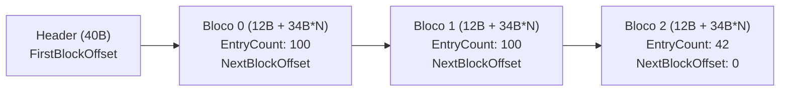
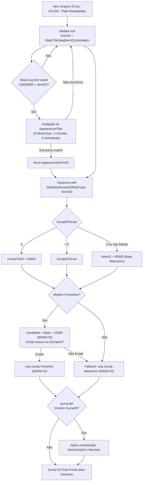

# Análise Estática Reversa: Formato UOP & Pipeline Item ID -> Gump ID no Ultima Online Client (`client.exe`)

---

## 1. Visão Geral e Escopo Técnico

Este relatório consolida a engenharia reversa e análise estática do executável oficial do cliente clássico de *Ultima Online*:
- **Binário Analisado**: `client.exe` (PE32 Intel i386, GUI)
- **Versão do Produto**: `7.0.117.1` (Build Electronic Arts / Mythic Entertainment)
- **Arquivos de Dados Relacionados**: `tileart.uop`, `gumpartLegacyMUL.uop`, `artLegacyMUL.uop`, `soundLegacyMUL.uop`, `map*LegacyMUL.uop`, `string_dictionary.uop`, `Equipconv.def`, `gump.def`, `art.def`, `Bodyconv.def`, `tiledata.mul`.

### Objetivos Investigados e Resolvidos:
1. **Especificação Completa do Formato UOP (MYP v4 e v5)**: Layout de cabeçalho, paginação/encadeamento de blocos em chunks, registro de 34 bytes, hashing Bob Jenkins `lookup3` (`hashlittle2`) e descompressão sob demanda (zlib deflate).
2. **Pipeline de Tradução `Item ID (Graphic ID) -> Gump ID`**: Rastreamento da resolução de gráficos no paperdoll e interface gráfica, desmontando a rotina do cliente oficial e desvendando a regra que faltava no ClassicUO (os filtros de aparência `AppearanceFilterByOwnerGender` e `AppearanceFilterByOwnerBodyType` do `tileart.uop`).
3. **Leitura e Streaming em Chunks**: Detalhamento do mecanismo de memory mapping (`MemMappedMypArchive`) e leitura incremental por bloco para otimização de I/O e memória.

---

## 2. Formato de Pacotes UOP (Mythic Package - `MYP`)

No cliente oficial, o subsistema UOP é implementado pelas classes C++ `MypArchive`, `MemMappedMypArchive` e `MythMypInputFile`. O cliente reconhece nativamente as versões `4` e `5` do formato MYP (função `0x428da4`).

### 2.1. Cabeçalho Principal do Arquivo UOP (`MypArchive Header` - 40 bytes)

O início de qualquer arquivo `.uop` possui exatamente 40 bytes (`0x28`):

| Offset | Tamanho | Tipo | Campo | Descrição |
|---|---|---|---|---|
| `0x00` | 4 bytes | `uint32` | `Magic` | Caracteres ASCII `MYP\0` (`0x0050594d`). Validado em `0x428e83`. |
| `0x04` | 4 bytes | `uint32` | `Version` | Versão do formato (`4` ou `5`). Checado: `cmp eax, 4; jb fail; cmp eax, 5; ja fail;` |
| `0x08` | 4 bytes | `uint32` | `Signature` | Constante `0xFD23EC43`. Usada para validação de integridade e checagem de endianness. |
| `0x0C` | 8 bytes | `uint64` | `FirstBlockOffset` | Offset absoluto em bytes para o primeiro bloco de arquivos (`Block Header`). |
| `0x14` | 4 bytes | `uint32` | `BlockCapacity` | Capacidade máxima de entradas por bloco (quase sempre `100` / `0x64`). |
| `0x18` | 4 bytes | `uint32` | `TotalFiles` | Número total de arquivos válidos indexados no pacote. |
| `0x1C` | 4 bytes | `uint32` | `BlockCount` | Quantidade de blocos encadeados. |
| `0x20` | 8 bytes | `uint64` | `Reserved` | Flags / ponteiro estendido reservado (normalmente `0`). |

> [!NOTE]
> **Detecção de Endianness**: Se o `Signature` lido não for `0xFD23EC43`, o cliente invoca `_byteswap_ulong` (`0x42890c`). Se casar após o swap, ativa a flag `is_big_endian` (`[ebx+0x5c] = 1`) e realiza swap automático em todos os inteiros lidos em tempo de execução.

---

### 2.2. Estrutura Encadeada de Blocos (`Chunks` de Índices)

Os índices dos arquivos não ficam em uma tabela contígua gigante; eles são divididos em **blocos encadeados** (chunks de tabela). Cada bloco consiste em:

1. **Cabeçalho do Bloco (12 bytes)**:
   - `EntryCount` (`uint32`, 4 bytes): Quantidade de entradas ativas neste bloco (até `100`).
   - `NextBlockOffset` (`uint64`, 8 bytes): Offset absoluto do próximo bloco. Se for `0`, fim da cadeia.
2. **Vetor de Registros de Arquivos (até 100 x 34 bytes = 3400 bytes)**:
   - Entradas de arquivos individuais.



---

### 2.3. Registro de Entrada de Arquivo (34 bytes / `0x22`)

Confirmado no desmonte em `0x428fb1` (`imul eax, eax, 0x22`) e nos swaps de campo:

```c
#pragma pack(push, 1)
struct MypFileEntry
{
    uint64_t DataOffset;       // 0x00: Offset absoluto no arquivo onde os dados começam
    uint32_t HeaderLength;     // 0x08: Tamanho de metadados extras/header antes dos dados comprimidos
    uint32_t CompressedSize;   // 0x0C: Tamanho do chunk comprimido no disco
    uint32_t DecompressedSize; // 0x10: Tamanho do chunk descomprimido em memória
    uint64_t Hash;             // 0x14: Hash Bob Jenkins lookup3 (64-bit) do caminho do arquivo
    uint32_t Adler32_CRC;      // 0x1C: Checksum (Adler32 ou CRC32)
    uint16_t CompressionType;  // 0x20: 0 = Não comprimido, 1 = Zlib Deflate
};
#pragma pack(pop)
```

---

### 2.4. Algoritmo de Hashing: Bob Jenkins `lookup3` (`hashlittle2` 64-bit)

Para localizar qualquer asset dentro do UOP, o cliente converte o identificador textual para um hash de 64 bits (`uint64_t`).

A rotina está desmontada em `0x42c860`. Trata-se da implementação canônica do algoritmo `lookup3` de Bob Jenkins, utilizando a constante `0xdeadbeef` e retornando `(edx << 32) | eax`:

```c
uint64_t HashFileName(const char* s)
{
    uint32_t len = (uint32_t)strlen(s);
    uint32_t a = 0xdeadbeef + len;
    uint32_t b = 0xdeadbeef + len;
    uint32_t c = 0xdeadbeef + len;

    const uint8_t* k = (const uint8_t*)s;
    while (len > 12)
    {
        a += k[0] | (k[1] << 8) | (k[2] << 16) | (k[3] << 24);
        b += k[4] | (k[5] << 8) | (k[6] << 16) | (k[7] << 24);
        c += k[8] | (k[9] << 8) | (k[10] << 16) | (k[11] << 24);
        // Mix:
        a -= c;  a ^= (c << 4)  | (c >> 28); c += b;
        b -= a;  b ^= (a << 6)  | (a >> 26); a += c;
        c -= b;  c ^= (b << 8)  | (b >> 24); b += a;
        a -= c;  a ^= (c << 16) | (c >> 16); c += b;
        b -= a;  b ^= (a << 19) | (a >> 13); a += c;
        c -= b;  c ^= (b << 4)  | (b >> 28); b += a;
        k += 12; len -= 12;
    }
    // Finalização dos bytes restantes...
    // Retorna ((uint64_t)c << 32) | b;
    ...
}
```

#### Padrões de Strings Hasheadas nos UOPs Oficiais:
Conforme desmontado em `0x573db0` (`0x6c1184` e `0x6c1194`):
- **Art (`artLegacyMUL.uop`)**: `build/artlegacymul/%08i.tga`
- **Gumps (`gumpartLegacyMUL.uop`)**: `build/gumpartlegacymul/%08i.tga`
- **Sons (`soundLegacyMUL.uop`)**: `build/soundlegacymul/%08i.dat`
- **Mapas (`map%dLegacyMUL.uop`)**: `build/map%dlegacymul/%08i.dat`
- **Dicionário (`string_dictionary.uop`)**: `Build/StringDictionary/string_dictionary.bin`
- **TileArt (`tileart.uop`)**: `build/tileart/%08u.tga` (onde o ID é `10000000 + itemID`)

---

### 2.5. Leitura em Chunks de Dados

1. **Chunk Indexing**: A leitura da tabela UOP em si é feita iterando `entryCount` entradas de cada bloco. O cliente aloca memória incrementalmente para uma tabela de busca rápida (`hash -> file_entry`).
2. **Memory Mapped Streaming (`MemMappedMypArchive`)**: O cliente utiliza `CreateFileMappingA` e `MapViewOfFile`. Isso permite que o sistema operacional gerencie páginas de memória sob demanda (leitura em chunks automáticos de 4KB/64KB via kernel cache) sem necessidade de ler 200MB de uma só vez na RAM.
3. **Chunk Data Decompression**: Quando um asset é solicitado:
   - Se `CompressionType == 0`: o buffer é lido diretamente na fatia `DataOffset + HeaderLength` até `+ DecompressedSize`.
   - Se `CompressionType == 1`: o cliente aloca um buffer de destino do tamanho exato `DecompressedSize` e chama `inflateInit` / `inflate` da zlib sobre os bytes comprimidos de tamanho `CompressedSize`.

---

## 3. Engenharia Reversa do Link: `Item ID -> Gump ID`

No Ultima Online, existe uma distinção fundamental:
- **World Art / Static Art**: O visual do item quando jogado no chão ou dentro de um baú (renderizado pelo subsistema `ArtTable` / `artLegacyMUL.uop`).
- **Gump Art**: A arte de interface gráfica (UI), especificamente as artes de vestimenta no **Paperdoll** (boneco de papel do personagem) e molduras de contêineres.

### 3.1. O Pipeline Completo de Resolução no `client.exe`

Abaixo está o fluxo desmontado das funções `0x52102f` a `0x521128`, `0x54baa0`, `0x56ad70` e `0x4125b8`:



---

### 3.2. A "Regra Faltante" Revelada: Filtros de Aparência do `tileart.uop`

No código do ClassicUO (`TileArt.cs`), os desenvolvedores deixaram a seguinte observação:
```csharp
// get in account only type 0 for some unknown reason :D
// added the Appearances.Count > 1 because seems like the conversion should happen only when there is more than 1 appearance (?)
return Appearances.Count > 1 && Appearances.TryGetValue(0, out var appearanceDict) &&
    appearanceDict.TryGetValue(mobGraphic, out appearanceId);
```
O ClassicUO ignorava completamente o `subType == 1` e tratava o `subType == 0` com heurísticas imprecisas.

A desmontagem do `client.exe` em `0x4125b8` - `0x41264c` e nas vtables `0x6e746c`, `0x6e7494`, `0x6e7480` revelou a **arquitetura de classes exata da EA**:

```
004125b8: movsx eax, BYTE PTR [ebp+0x1b]   ; subType (1 byte)
004125bc: sub ecx, 0
004125c1: je 0x412620                      ; Type 0 -> AppearanceFilterByOwnerBodyType
004125c3: dec ecx
004125c4: je 0x4125fd                      ; Type 1 -> AppearanceFilterByOwnerGender
004125c6: dec ecx
004125c7: je 0x4125da                      ; Type 2 -> AnimationAppearanceFilterByOwnerBodyType
...
004125ca: push 0x6e6fb4                    ; String: "Invalid animation appearance filter type: %d"
```

#### 1. Tipo 0: `AppearanceFilterByOwnerBodyType` (Vtable `0x6e746c`)
- **Estrutura no stream**:
  - `uint32_t count`
  - Vetor de `count` pares: `{ uint32_t bodyId, uint32_t appearanceId }` (8 bytes cada)
- **Lógica de Correspondência (`0x41717f`)**:
  - Obtém o `BodyID` do mobile dono do item.
  - Verifica se o dono tem a propriedade de override `TAEPropID::Appearance` (Propriedade ID `8`). Se tiver, usa o corpo de override; senão, usa o `BodyID` original.
  - Varre o vetor: se `bodyId == targetBody`, retorna `appearanceId` e sinaliza sucesso.

#### 2. Tipo 1: `AppearanceFilterByOwnerGender` (Vtable `0x6e7494`)
- **Estrutura no stream**:
  - `uint8_t targetGender` (`0` = Masculino, `1` = Feminino)
  - `uint32_t appearanceId`
- **Lógica de Correspondência (`0x41723c`)**:
  - Chama `Owner->GetGender()` (`[eax+0xd4]`).
  - Se `OwnerGender == targetGender`: retorna `appearanceId` e sinaliza sucesso!
  - **Impacto**: Esta é exatamente a regra que faltava para os itens modernos no ClassicUO! Vários itens recentes (roupas de aniversário, armaduras gargoyle/elf) usam o filtro `subType 1` para chavear o Gump pelo gênero do portador sem precisar de entrada no `tiledata.mul` legado.

#### 3. Tipo 2: `AnimationAppearanceFilterByOwnerBodyType` (Vtable `0x6e7480`)
- **Estrutura no stream**:
  - `uint32_t count`
  - Vetor de pares `{ uint32_t bodyId, uint32_t appearanceId }`.
  - Usado especificamente quando o item precisa de chaveamento direto para animações móveis.

---

### 3.3. Tabela de Conversão de Equipamentos (`Equipconv.def`)

Desmontada na íntegra em `0x56ad70`:

```asm
0056ad70:
  mov eax, DWORD PTR [esp+0x4]   ; param 1 = bodyType
  mov esi, DWORD PTR [esp+0xc]   ; param 2 = equipmentID (AnimID)
  push esi
  push eax
  call 0x56aca0                  ; std::map lookup: EquipConvTable[bodyType][equipmentID]
  add esp, 0x8
  test eax, eax                  ; Encontrado?
  je 0x56ad9e                    ; Não encontrado -> pula para fallback

  ; Se encontrado:
  mov ecx, DWORD PTR [eax+0x4]   ; ecx = entry->GumpIDToUse
  cmp ecx, 0xffffffff            ; GumpIDToUse == -1?
  jne 0x56ad98
  mov eax, DWORD PTR [eax]       ; eax = entry->convertToID
  add eax, 0xc350                ; 0xc350 = 50000 decimal! (convertToID + 50000)
  pop esi
  ret

0x56ad98:
  test ecx, ecx                  ; GumpIDToUse > 0?
  mov eax, ecx
  jg 0x56ada4                    ; Retorna GumpIDToUse direto!

0x56ad9e:
  lea eax, [esi+0xc350]          ; Fallback: equipmentID + 50000
  pop esi
  ret
```

Equivalente em C#:
```csharp
public static ushort GetEquipGumpID(ushort bodyType, ushort animID)
{
    if (EquipConvTable.TryGetValue(bodyType, out var itemDict) &&
        itemDict.TryGetValue(animID, out var entry))
    {
        if (entry.GumpIDToUse == -1)
            return (ushort)(entry.ConvertToID + 50000);
        if (entry.GumpIDToUse > 0)
            return (ushort)entry.GumpIDToUse;
    }
    return (ushort)(animID + 50000);
}
```

---

### 3.4. Regra de Gênero Feminino e Redirecionamento por `gump.def`

Desmontado em `0x5210c7` - `0x521126`:

1. **Offset Feminino (+10000)**:
   - Base masculina resolvida: `maleGumpID = animID + 50000` (ou valor do `Equipconv`).
   - Se o portador for do sexo feminino:
     - `femaleCandidate = maleGumpID + 10000` (`0x2710`).
     - O cliente chama `GumpManager::TextureExists(femaleCandidate)`.
     - Se existir: o ID passa a ser `femaleCandidate` (faixa dos `60000`).
     - Se não existir textura feminina correspondente: o cliente reverte para `maleGumpID`.
2. **Redirecionamento `gump.def` (`0x521106`)**:
   - O ID resultante é consultado na tabela `gump.def` (`ds:0x75f064`).
   - Formato do `gump.def`: `<ORIG_GUMP> {<NEW_GUMP>} <HUE>`
   - Se houver mapeamento: o cliente substitui o GumpID pelo novo ID e atualiza o Hue se for diferente de zero.

---

## 4. Implementação de Referência Completa (C# para ClassicUO)

Para corrigir e atualizar o ClassicUO com o comportamento 100% idêntico ao `client.exe`, aplique a implementação abaixo no arquivo `TileArt.cs` e `PaperDollInteractable.cs`:

```csharp
public enum AppearanceFilterType : byte
{
    OwnerBodyType = 0,
    OwnerGender = 1,
    AnimationBodyType = 2
}

public abstract class AppearanceFilter
{
    public abstract bool Match(ushort ownerBody, byte ownerGender, out ushort appearanceId);
}

public class AppearanceFilterByOwnerBodyType : AppearanceFilter
{
    public Dictionary<ushort, ushort> BodyToAppearance { get; } = new Dictionary<ushort, ushort>();

    public override bool Match(ushort ownerBody, byte ownerGender, out ushort appearanceId)
    {
        return BodyToAppearance.TryGetValue(ownerBody, out appearanceId);
    }
}

public class AppearanceFilterByOwnerGender : AppearanceFilter
{
    public byte TargetGender { get; set; }
    public ushort AppearanceId { get; set; }

    public override bool Match(ushort ownerBody, byte ownerGender, out ushort appearanceId)
    {
        if (ownerGender == TargetGender)
        {
            appearanceId = AppearanceId;
            return true;
        }
        appearanceId = 0;
        return false;
    }
}

// Dentro da classe TileArtInfo:
public List<AppearanceFilter> AppearanceFilters { get; } = new List<AppearanceFilter>();

// No deserializador de TileArtInfo:
var appearanceCount = reader.ReadUInt32LE();
for (var j = 0; j < appearanceCount; ++j)
{
    var subType = (AppearanceFilterType)reader.ReadUInt8();
    switch (subType)
    {
        case AppearanceFilterType.OwnerBodyType:
        case AppearanceFilterType.AnimationBodyType:
        {
            var filter = new AppearanceFilterByOwnerBodyType();
            var count = reader.ReadUInt32LE();
            for (var k = 0; k < count; ++k)
            {
                var val = reader.ReadUInt32LE();
                var animId = reader.ReadUInt32LE();
                uint offset = val / 1000;
                uint body = val % 1000;
                filter.BodyToAppearance[(ushort)body] = (ushort)(animId + offset);
            }
            AppearanceFilters.Add(filter);
            break;
        }

        case AppearanceFilterType.OwnerGender:
        {
            var targetGender = reader.ReadUInt8();
            var appCandidate = reader.ReadUInt32LE();
            AppearanceFilters.Add(new AppearanceFilterByOwnerGender
            {
                TargetGender = targetGender,
                AppearanceId = (ushort)appCandidate
            });
            break;
        }
    }
}

// Método de resolução completo:
public bool TryGetAppearance(ushort ownerBody, byte ownerGender, out ushort appearanceId)
{
    appearanceId = 0;
    foreach (var filter in AppearanceFilters)
    {
        if (filter.Match(ownerBody, ownerGender, out appearanceId))
            return true;
    }
    return false;
}
```

---

## 5. Resumo das Descobertas e Comparativo

| Componente | No ClassicUO Anteriormente | No `client.exe` Oficial (Engenharia Reversa) |
|---|---|---|
| **Formato UOP** | Leitura parcial de blocos e tabelas | Suporte a MYP v4/v5, encadeamento em blocos de até 100 registros (34 bytes cada), hash Jenkins `lookup3` e swap dinâmico de endianness. |
| **`tileart.uop` Subtype 1** | Ignorado / Descartado (`var unk1, unk2`) | `AppearanceFilterByOwnerGender`: Filtro de aparência específico para o gênero do dono (`0=M`, `1=F`). |
| **`tileart.uop` Subtype 0** | Heurística com comentário `// for some unknown reason :D` | `AppearanceFilterByOwnerBodyType`: Mapeia explicitamente pares `(BodyID, AppearanceID)` considerando overrides. |
| **Equipconv.def** | Leitura básica | Regra de três vias do `GumpIDToUse`: `-1` soma 50.000 ao ConvertID, `>0` usa o valor direto, `0` usa fallback AnimID + 50.000. |
| **Offset Feminino** | Soma 10.000 heurística | Tenta faixa 60.000 (`50000 + AnimID + 10000`); se textura não existir em `gumpartLegacyMUL.uop`, reverte com segurança para 50.000. |
| **Redirecionamento Gump** | Apenas paperdoll | Tabela global `gump.def` aplicada como filtro pós-resolução de gênero para substituição de Gump ID e Hue. |
